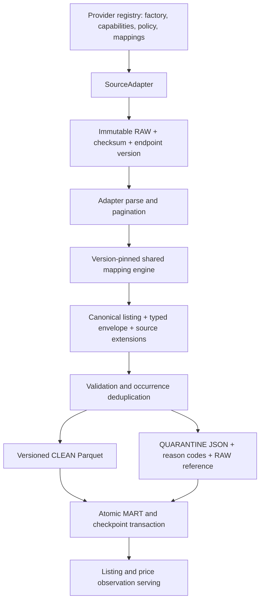

# Source onboarding and architecture

## Existing and added behavior

Existing storage ownership, immutable uploads, request identity, transaction locks,
budgeting, retry, retention checks, price snapshots and recovery are retained.
New behavior: provider registry, capabilities/policy contracts, declarative field
mapping, schema/mapping pins, listing envelope and extensions, CLEAN v2 reader/
writer, source CHECK migration, and explicit offline simulated provider.
Only listing entities are currently supported. The typed `ListingPayload` is
separate from `CanonicalEnvelope` provenance; `CanonicalListing.envelope()` exposes
that representation. CLEAN uses the equivalent flat listing representation for
backward-compatible readers. Other entity kinds require typed payloads, routing,
storage contracts and forward migrations; they are rejected rather than treated
as listings or sales.

## Register a source

1. Implement `SourceAdapter` in a provider-specific module. Declare source ID,
   endpoint version, entity kinds and actual capabilities. `fetch` returns original
   bytes; `parse` returns records and a continuation flag. Keep authentication,
   cursor validation, safe error diagnostics and pagination inside the adapter.
2. Define immutable `MappingSpec` versions using `FieldRule` (target, alternative
   dot paths, conversion, required flag, explicit default). Retain old mappings.
   Supported listing mapping targets: identity, title, amount, currency, brand,
   model, variant. Register source schema compatibility in each mapping.
3. Register `Provider` with factory, default marketplace, capabilities, policy and
   mappings in the composition root or an explicit application bootstrap. Reject
   duplicate registrations and unknown sources. No changes to acquisition,
   cleaning, runtime dispatch or existing adapters should be needed.
4. Add acquisition YAML queries. `load_plan` uses provider bounds and categories.
   New live registrations become CLI choices and collect workers; explicitly
   review inclusion in collection before enabling a production provider.
5. Run offline contract, mapping, storage-layer, duplicate, replay, interruption,
   provenance, schema evolution and isolation tests before considering API tests.
   Live collection is a separate authorized action with private credentials.

The simulated experiment adds **one provider-specific implementation module**,
`adapters/simulated.py`, **one fixture JSON**, **one YAML plan**, and its test module.
Registration is explicit in the experiment bootstrap, not automatic in production.
It adds **zero shared-core file modifications at onboarding** and no changes to
eBay/Rakuten adapters. This is an implementation change count, not a timed human
onboarding study. The preceding general architecture refactor did change core files.
Configuration cannot describe arbitrary semantics; provider-specific converters
may require an explicitly reviewed extension to the mapping vocabulary.

## Mapping and quality

Nested paths and aliases reject conflicting values. Missing optional values remain
null; defaults are explicit. Conversion supports text/NFC, exact decimals and aware
timestamps normalized to UTC. Boolean/float prices, non-finite decimals, excessive
precision, missing identity/title, unknown categories and invalid currencies are
quarantined. eBay and Rakuten retain their original reason codes and required-field
validation. Legacy optional brand/model/variant handling is retained for old plans;
v2 rejects invalid optional-field types explicitly. Errors use fixed reason
codes such as `mapping.invalid_type.amount` and `mapping.ambiguous_alias.title`.
Rakuten's JPY default applies only to its configured Japanese marketplace.

New CLEAN preserves the source record in validated `attributes_json`; exact source
decimals there are strings, while original numeric representation remains in RAW.
Keeping an attribute in extensions is preservation, not semantic standardization.
Business hashes deliberately retain the original listing/price fields; extension
changes alone do not create a conflicting duplicate. All source occurrences remain
traceable through RAW, including excluded duplicates. Identity is source + market +
source ID within the listing entity/table namespace; the existing key digest is
unchanged. This is not cross-source product matching. A new run can create another
observation; identical replay within a run cannot create another snapshot.

## Evolution and migration

New plans pin mapping version, canonical schema version and endpoint version before
upload. Resume validates the pin and refuses incompatible endpoint changes. New
aliases/optional fields can be handled through new mappings. Unknown source schema
versions fail explicitly. Start a new run for a changed source/mapping contract;
never overwrite old immutable RAW or CLEAN to force a migration.

Plans lacking pins use `legacy-1` and CLEAN v1. Its old schema and business hashes
remain available, including recovery of output uploads before commit. New plans
use CLEAN v2 (mapping_version and entity_kind columns); decode accepts both exact
schemas and rejects others. Empty outputs use the version pinned in the query.

Migration **0007** replaces only the source-name CHECK constraint with a validated
safe identifier constraint. No data/table/index is removed and no primary key is
rewritten. Apply through the existing `marketpipe init` in an owned namespace while
workers are stopped. Downgrade is deliberately disabled; narrowing source IDs could
invalidate retained data. Old migrations must remain. Storage integration must be
verified when an isolated PostgreSQL/MinIO runtime is available.

## Provider limits and evidence

Verified against official documentation on 2026-11-03:

- [eBay Browse search](https://developer.ebay.com/develop/api/buy/browse_api/item/search): page size up to
  200 and accessible result window up to 10,000. The adapter retains OAuth and
  validates continuation URL, offset and limit. The registry's maximum page count
  allows small pages within this result window; per-query result caps still apply.
- [Rakuten Ichiba 2026-07-01](https://webservice.rakuten.co.jp/documentation/ichiba-item-search):
  accessKey plus applicationId, hits up to 30 and page up to 100. The adapter
  preserves formatVersion 2, required website headers and existing diagnostics.

The one-second minimum and three retries are application policy, not a claim about
account quota. Account-specific rate/retention conditions must be verified privately;
the code does not invent universal quotas or retention periods. Supported eBay
marketplace selection remains account/configuration dependent. No API acquisition
was performed for this experiment.
